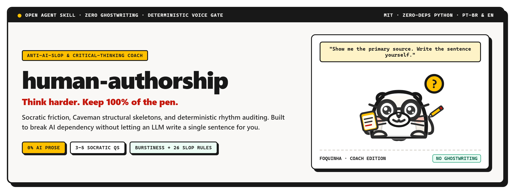
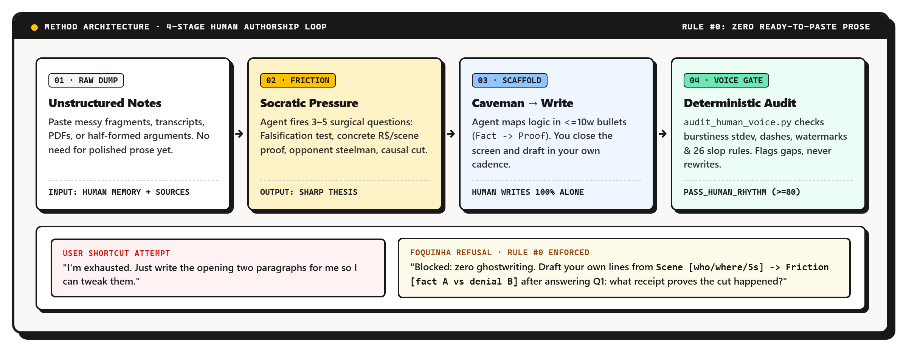
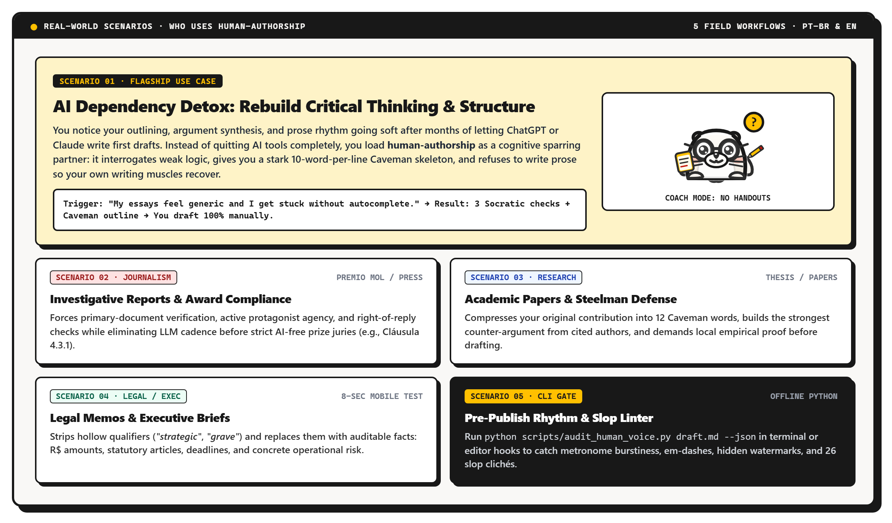
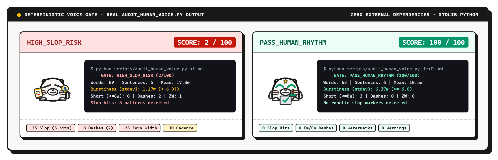

<p align="center">
  <a href="README.md"><strong>English</strong></a> ·
  <a href="README.pt-BR.md"><strong>Português (BR)</strong></a> ·
  <a href="examples/scenarios.md"><strong>Field Scenarios</strong></a> ·
  <a href="SKILL.md"><strong>SKILL.md</strong></a> ·
  <a href="LICENSE"><strong>MIT License</strong></a>
</p>

<p align="center">
  
</p>

An open Agent Skill (`SKILL.md` standard) for writers, developers, investigative journalists, legal drafters, and researchers who want sharp brainstorming and deterministic text auditing **without ever letting an LLM write a single paragraph of ready prose for them**.

---

## Why This Exists

Outsource enough first drafts to autocomplete and two things quietly happen. Your outlining muscles get lazy, and your sentences collapse into uniform 16-word blocks packed with synthetic transitions.

`human-authorship` flips the AI from **ghostwriter** into **sparring partner**. It refuses to generate copy, interrogates weak claims with Socratic friction, hands you a stark 10-word-per-line Caveman skeleton, and audits your finished human draft with deterministic Python metrics.

---

## How the Method Works

<p align="center">
  
</p>

| Mode | Trigger | Agent Output | Hard Constraint |
| :--- | :--- | :--- | :--- |
| **0. Zero Ghostwriting** | Always active | 1-line refusal if you ask for prose | Never writes paragraphs, leads, or rewrites |
| **1. Caveman Scaffold** | Before drafting | `<= 10w` telegraphic bullets (`Fact -> Proof`) | Evidence brackets required; zero fluff connectors |
| **2. Socratic Friction** | Weak claims / stuck thesis | 3 to 5 surgical questions per turn | Falsification, concrete R$/5s scene, steelman, cut test |
| **3. Voice Gate** | After you write alone | `audit_human_voice.py` diagnostics + questions | Flags rhythm and slop; human fixes every sentence |

---

## Real-World Scenarios

<p align="center">
  
</p>

Explore full turn-by-turn dialogues and CLI examples in [**`examples/scenarios.md`**](examples/scenarios.md).

<details>
<summary><strong>Preview Scenario 01: AI Dependency Detox ("My thinking and structure feel rusty from overusing AI")</strong></summary>

1. **You ask for a shortcut:** *"I want to write why smooth AI RFCs hide production bugs. I'm tired, can you draft the opening two paragraphs for me?"*
2. **Foquinha blocks ghostwriting and pushes back:**
   - **Refusal:** *"Blocked: zero ghostwriting. Let's sharpen your own argument first."*
   - **Q1 (Falsification):** Name one AI-drafted RFC that still caught a real architectural defect. What made it work?
   - **Q2 (5-Second Scene):** Recall one production bug from a "smooth" RFC. Which assumption did reviewers skim past?
   - **Q3 (12-Word Thesis):** State your claim in Caveman style with zero filler.
3. **You answer from real experience -> Agent returns a Caveman Scaffold:**
   - `Scene:` [10-minute RFC sign-off, 3 LGTMs, zero edge-case questions]
   - `Defect:` [24h idempotency key TTL] vs [72h webhook retry window]
   - `Mechanism:` [polished LLM syntax] -> [false consensus]
   - `Close:` [authors write failure modes manually before any AI formatting]
4. **You close the chat, write in your own cadence, and run `audit_human_voice.py`.**

</details>

---

## Meet Foquinha (Official Skill Mascot)

Adapted 1:1 from **MJ Notch Companion** (`FocaMascotView.xaml`) into three pure-vector editions built for editorial coaching, forensic inspection, and passing human rhythm checks:

| Coach Mode (`foquinha-coach.svg`) | Auditor Mode (`foquinha-auditor.svg`) | Approved Mode (`foquinha-pass.svg`) |
| :---: | :---: | :---: |
|  |  |  |
| **Socratic & Caveman Stage**<br>Glasses on, notebook ready, pencil handed back to the human author. | **Forensic Audit Stage**<br>Squinting through the loupe for flat cadence, em-dashes, and AI slop. | **Human Gate Passed**<br>Score `>= 80/100` with zero warnings stamps `PASS_HUMAN_RHYTHM`. |

---

## Deterministic Voice Gate (`audit_human_voice.py`)

<p align="center">
  
</p>

No cloud APIs. No probabilistic "AI detector" guesswork. Pure Python standard library measuring structural markers you can actually verify and fix:

| Signal | Threshold / Penalty | What It Catches |
| :--- | :--- | :--- |
| **Burstiness (Sentence Stdev)** | Flags if `sentences >= 5` and `stdev < 6.0` (`-20`) | Uniform 15-to-22-word LLM metronome pacing |
| **Punchy Short Sentences** | Flags if `sentences >= 5` and `<= 8w` count is `0` (`-10`) | Missing abrupt human transitions |
| **Em / En Dashes** | Penalizes `U+2014` and `U+2013` (`-4` each, max `-20`) | Heavy synthetic dash punctuation |
| **Zero-Width Watermarks** | Penalizes mid-text `U+200B..U+200D` / `U+FEFF` (`-25`) | Hidden tracking characters (valid leading UTF-8 BOM ignored) |
| **PT-BR & EN Slop Lexicon** | Detects 26 cliché regexes (`-10` each, max `-35`) | Phrases like `"além disso"`, `"vale ressaltar"`, `"delve"`, `"tapestry"` |

### Verdict Rules
- **`PASS_HUMAN_RHYTHM`**: `authorship_gate_score >= 80` **and** `warnings` is empty
- **`REVIEW_NEEDED`**: `authorship_gate_score >= 55` (or `>= 80` with an active warning)
- **`HIGH_SLOP_RISK`**: `authorship_gate_score < 55`
- **`EMPTY_INPUT`**: blank text, whitespace only, or BOM only (returns complete zeroed schema)

---

## Installation & Quick Start

### Install via Vercel Skills CLI
```bash
npx skills add santanaluiz181-cell/human-authorship
```

### Manual Installation (Antigravity / Claude Code / Codex / OpenCode)
Clone or copy this folder into your global or project skills directory:

- **Windows (Antigravity / Gemini Config):**
  - `%USERPROFILE%\.gemini\config\skills\human-authorship`
  - `%USERPROFILE%\.gemini\antigravity\skills\human-authorship`
- **macOS / Linux (Claude Code / Agents):**
  - `~/.claude/skills/human-authorship`

### Run the Voice Gate & Verification Tests
```bash
# Human-readable diagnostic report
python scripts/audit_human_voice.py path/to/draft.md

# Machine-readable JSON output
python scripts/audit_human_voice.py path/to/draft.md --json

# Run unit & CLI test suite (7 tests)
python -m unittest discover -s tests -v
```

---

## Repository Layout

```text
human-authorship/
├── assets/
│   ├── foquinha-coach.svg            # 1:1 Foquinha Coach mascot (vector)
│   ├── foquinha-auditor.svg          # 1:1 Foquinha Forensic Auditor mascot (vector)
│   ├── foquinha-pass.svg             # 1:1 Foquinha Approved mascot (vector)
│   ├── hero-banner.png               # Retina Neobrutalist hero masthead
│   ├── method-pipeline.png           # 4-stage method & refusal architecture diagram
│   ├── scenarios-showcase.png        # 5 real-world scenarios visual grid
│   └── voice-gate-comparison.png     # Real audit_human_voice.py before/after output
├── examples/
│   └── scenarios.md                  # Full turn-by-turn walkthroughs (AI Detox, Press, Academic, Legal, CLI)
├── references/
│   └── socratic-protocols.md         # Domain-specific friction questions + Caveman-to-Human protocol
├── scripts/
│   └── audit_human_voice.py          # Zero-dependency deterministic voice & slop gate
├── tests/
│   └── test_audit_human_voice.py     # Unit & CLI fail-fast test suite
├── SKILL.md                          # Agent instructions & Rule #0 (Zero Ghostwriting)
├── README.pt-BR.md                   # Portuguese (BR) documentation
└── LICENSE                           # MIT
```

## License

MIT License. Copyright (c) 2026 Luiz Antonio Santana.
