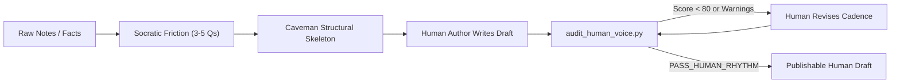

# human-authorship

**Socratic Anti-AI-Slop & Critical-Thinking Coach for 100% Human Authorship.**

An open Agent Skill (`SKILL.md` standard) for writers, investigative journalists, legal drafters, and researchers who want sharp brainstorming and deterministic text auditing **without ever letting an LLM write a single paragraph of ready prose for them**.

---

## Core Philosophy

1. **Zero Prose Generation:** The agent is strictly forbidden from writing finished paragraphs, introductions, or rewrites on behalf of the author.
2. **Caveman Scaffolding:** Ideas and verified facts are laid out as stripped-down structural skeletons (`Fact -> Tension -> Evidence`), forcing the human author to supply their own syntax, cadence, and voice.
3. **Socratic Friction:** Up to 5 targeted questions stress-test primary sources, contradictions, counter-arguments (steelman), and concrete numbers before drafting.
4. **Deterministic Post-Draft Gate (`audit_human_voice.py`):** Offline Python linter (zero external dependencies) measuring synthetic LLM markers rather than probabilistic "AI detector" guesswork.



---

## What `audit_human_voice.py` Measures

| Signal | Threshold / Rule | Why It Matters |
| :--- | :--- | :--- |
| **Burstiness (Sentence Stdev)** | Flags if `sentences >= 5` and `stdev < 6.0` | Uniform 14-20 word cadence reads like synthetic autocomplete. |
| **Punchy Short Sentences** | Flags if `sentences >= 5` and `<= 8w` count is `0` | Human rhythm breathes through abrupt transitions. |
| **Em / En Dashes** | Penalizes `U+2014` and `U+2013` (`-4` each, max `-20`) | Heavy em-dash usage is a recurring synthetic cadence signature. |
| **Zero-Width Watermarks** | Penalizes `U+200B..U+200D` and mid-text `U+FEFF` (`-25`) | Strips/detects hidden tracking spaces while ignoring valid UTF-8 BOM. |
| **PT-BR & EN Slop Lexicon** | Detects 26 cliché patterns (`-10` each, max `-35`) | Catches phrases like `"além disso"`, `"vale ressaltar"`, `"delve"`, `"tapestry"`. |

---

## Installation

### Via Vercel Skills CLI (`npx skills`)
```bash
npx skills add santanaluiz181-cell/human-authorship
```

### Manual Installation (Antigravity / Claude Code / Codex / OpenCode)
Copy this folder into your global or project skills directory:

- **Windows (Antigravity / Gemini Config):**
  `%USERPROFILE%\.gemini\config\skills\human-authorship`
  `%USERPROFILE%\.gemini\antigravity\skills\human-authorship`
- **macOS / Linux (Claude Code / Agents):**
  `~/.claude/skills/human-authorship`

---

## Running the Voice Gate

```bash
# Human-readable diagnostic report
python scripts/audit_human_voice.py path/to/draft.md

# Structured JSON output
python scripts/audit_human_voice.py path/to/draft.md --json
```

### Running Tests
```bash
python -m unittest discover -s tests -v
```

---

## Repository Structure

```text
human-authorship/
├── SKILL.md                          # Agent behavior & hard non-ghostwriting rules
├── references/
│   └── socratic-protocols.md         # Domain protocols (Journalism, Academic, Executive)
├── scripts/
│   └── audit_human_voice.py          # Zero-dependency deterministic voice & slop gate
├── tests/
│   └── test_audit_human_voice.py     # Unit & CLI verification suite
├── LICENSE                           # MIT
└── README.md
```

## License

MIT License. Copyright (c) 2026 Luiz Antonio Santana.
