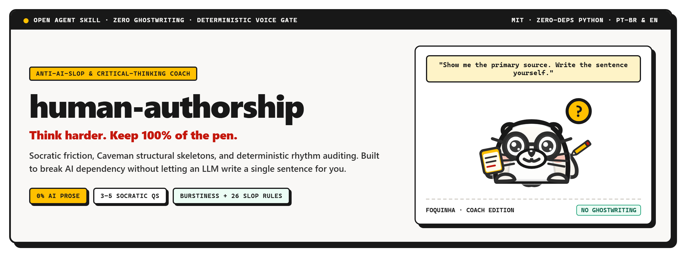
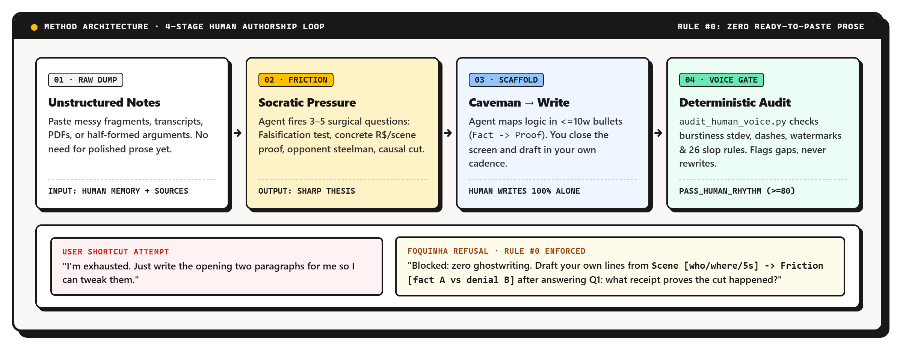
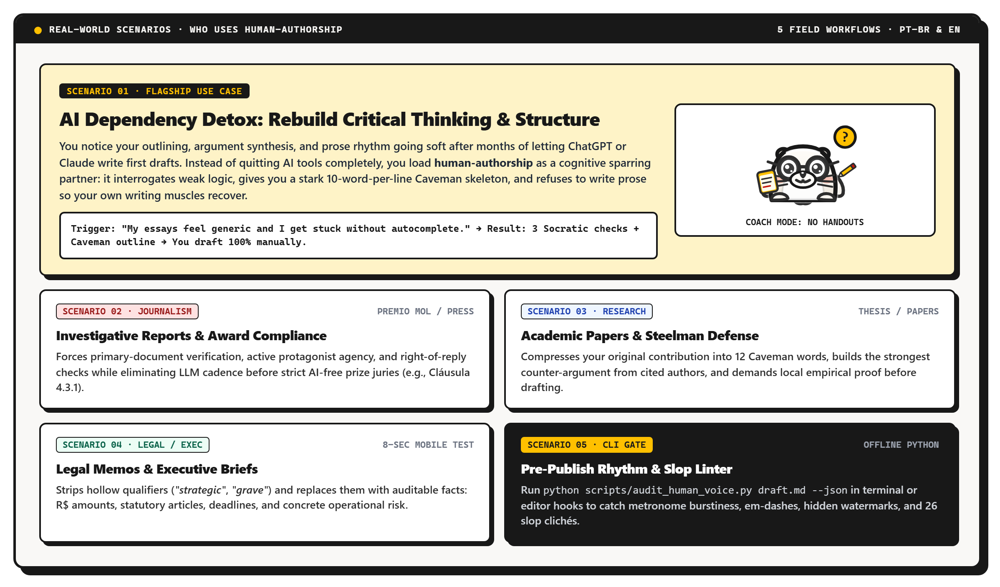
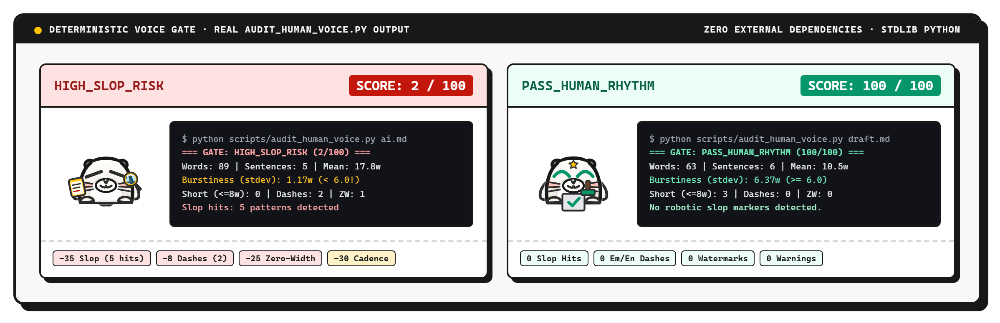

<p align="center">
  <a href="README.md"><strong>English</strong></a> ·
  <a href="README.pt-BR.md"><strong>Português (BR)</strong></a> ·
  <a href="examples/scenarios.md"><strong>Cenários Práticos</strong></a> ·
  <a href="SKILL.md"><strong>SKILL.md</strong></a> ·
  <a href="LICENSE"><strong>Licença MIT</strong></a>
</p>

<p align="center">
  
</p>

Uma Agent Skill aberta (padrão `SKILL.md`) para escritores, desenvolvedores, jornalistas investigativos, redatores jurídicos e pesquisadores que querem destravar ideias e auditar ritmo **sem nunca deixar uma IA escrever um único parágrafo pronto no lugar do autor**.

---

## Por que esta skill existe

Quando você terceiriza rascunhos demais para o autocompletar de um LLM, duas perdas acontecem rápido. O músculo de estruturar argumentos enferruja, e suas frases convergem para blocos previsíveis de 16 palavras cheios de conectivos artificiais.

O `human-authorship` inverte o papel da IA: de **ghostwriter** para **sparring cognitivo**. A skill bloqueia redação pronta, pressiona sua tese com perguntas socráticas, entrega um esqueleto telegráfico em modo Caveman e audita seu rascunho humano com métricas determinísticas em Python.

---

## Como o método funciona

<p align="center">
  
</p>

| Modo | Quando dispara | Entrega do agente | Trava obrigatória |
| :--- | :--- | :--- | :--- |
| **0. Zero Ghostwriting** | Sempre ativo | Recusa em 1 linha se você pedir prosa pronta | Nunca escreve parágrafos, leads ou reescritas |
| **1. Caveman Scaffold** | Antes de escrever | Tópicos `<= 10` palavras (`Fato -> Prova`) | Exige evidência entre `[colchetes]`; zero encheção |
| **2. Atrito Socrático** | Tese vaga ou travada | 3 a 5 perguntas cirúrgicas por turno | Falsificação, objeto/R$/cena 5s, steelman, corte bruto |
| **3. Portão Métrico** | Pós-rascunho humano | Saída do `audit_human_voice.py` + perguntas | Aponta cadência e vícios; humano reescreve sozinho |

---

## Cenários reais de uso

<p align="center">
  
</p>

Veja diálogos completos turno a turno e comandos em [**`examples/scenarios.md`**](examples/scenarios.md).

<details>
<summary><strong>Ver Cenário 01: Detox de Muleta de IA ("Sinto meu pensamento crítico e estruturação fracos")</strong></summary>

1. **Você pede um atalho:** *"Quero escrever por que RFCs geradas por IA escondem bugs de produção. Estou cansado, escreve dois parágrafos iniciais para eu ir editando."*
2. **A Foquinha bloqueia e devolve atrito real:**
   - **Recusa:** *"Bloqueado: zero ghostwriting. Vamos afiar seu próprio argumento antes."*
   - **P1 (Falsificação):** Cite uma RFC feita com IA que mesmo assim pegou uma falha grave de arquitetura. O que funcionou ali?
   - **P2 (Cena de 5s):** Qual bug real nasceu de um texto "lisinho"? Que premissa exata passou batida na revisão?
   - **P3 (Tese em 12 palavras):** Resuma sua tese em modo Caveman, sem adjetivos.
3. **Você responde com fatos reais -> Agente entrega o Esqueleto Caveman:**
   - `Cena:` [aprovação de RFC em 10 min, 3 LGTMs, zero pergunta de borda]
   - `Falha:` [chave de idempotência expira em 24h] vs [webhook tenta por 72h]
   - `Mecanismo:` [prosa polida de LLM] -> [falso consenso na leitura rápida]
   - `Fecho:` [autor escreve modos de falha na mão antes de qualquer formatação]
4. **Você fecha o chat, redige na própria voz e roda `audit_human_voice.py`.**

</details>

---

## Conheça a Foquinha (Mascote Oficial da Skill)

Cópia vetorial 1:1 portada do **MJ Notch Companion** (`FocaMascotView.xaml`) em três estados pensados para coaching editorial, apuração forense e aprovação de cadência humana:

| Modo Coach (`foquinha-coach.svg`) | Modo Auditora (`foquinha-auditor.svg`) | Modo Aprovado (`foquinha-pass.svg`) |
| :---: | :---: | :---: |
|  |  |  |
| **Coaching Socrático & Caveman**<br>Óculos de checagem, bloco pronto e lápis devolvido para a mão do autor. | **Auditoria Forense**<br>Olhar estreito e lupa procurando ritmo metrônomo, travessões e clichês de IA. | **Ritmo Humano Validado**<br>Nota `>= 80/100` sem alertas ganha o carimbo `PASS_HUMAN_RHYTHM`. |

---

## Portão Métrico Determinístico (`audit_human_voice.py`)

<p align="center">
  
</p>

Sem APIs na nuvem. Sem chute probabilístico de "detector de IA". Python puro (apenas stdlib) medindo sinais objetivos que você consegue conferir e corrigir:

| Sinal | Limiar / Penalidade | O que detecta |
| :--- | :--- | :--- |
| **Burstiness (Desvio-padrão)** | Alerta se `sentences >= 5` e `stdev < 6.0` (`-20`) | Cadência robótica uniforme de 15 a 22 palavras por frase |
| **Frases Curtas de Impacto** | Alerta se `sentences >= 5` e `<= 8w` for `0` (`-10`) | Falta de transições secas e respiro humano |
| **Travessões (`U+2014` / `U+2013`)** | `-4` por ocorrência (teto `-20`) | Excesso de travessões típicos de geração sintética |
| **Zero-Width Watermarks** | `-25` se houver `U+200B..U+200D` / `U+FEFF` no meio | Rastreamento invisível (BOM UTF-8 no início do arquivo é ignorado) |
| **Léxico Slop (PT-BR & EN)** | 26 regexes (`-10` cada padrão, teto `-35`) | Vícios como `"além disso"`, `"vale ressaltar"`, `"delve"`, `"tapestry"` |

---

## Instalação & Uso Rápido

### Via Vercel Skills CLI
```bash
npx skills add santanaluiz181-cell/human-authorship
```

### Instalação Manual (Antigravity / Claude Code / Codex / OpenCode)
Copie a pasta para o diretório de skills do seu ambiente:
- **Windows:** `%USERPROFILE%\.gemini\config\skills\human-authorship` ou `%USERPROFILE%\.gemini\antigravity\skills\human-authorship`
- **macOS / Linux:** `~/.claude/skills/human-authorship`

### Comandos do Auditor & Testes
```bash
# Relatório legível no terminal
python scripts/audit_human_voice.py caminho/do/rascunho.md

# Saída estruturada em JSON
python scripts/audit_human_voice.py caminho/do/rascunho.md --json

# Rodar suíte de testes unitários e de CLI (7 testes)
python -m unittest discover -s tests -v
```

---

## Licença

MIT License. Copyright (c) 2026 Luiz Antonio Santana.
